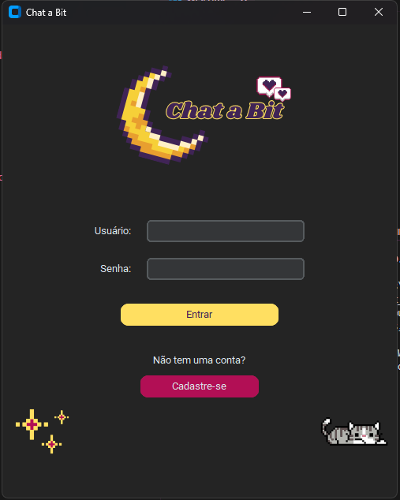
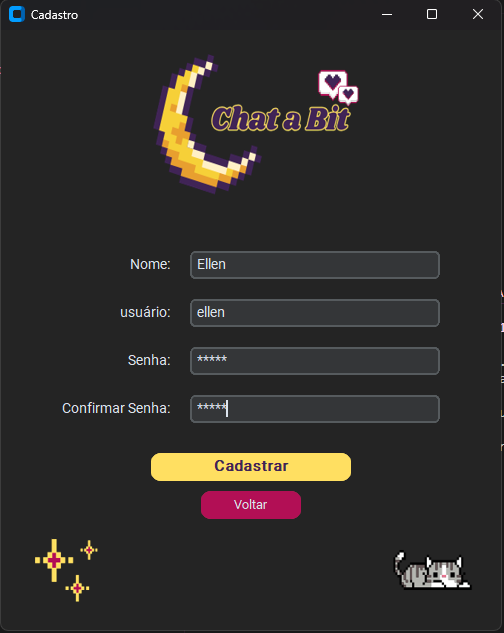
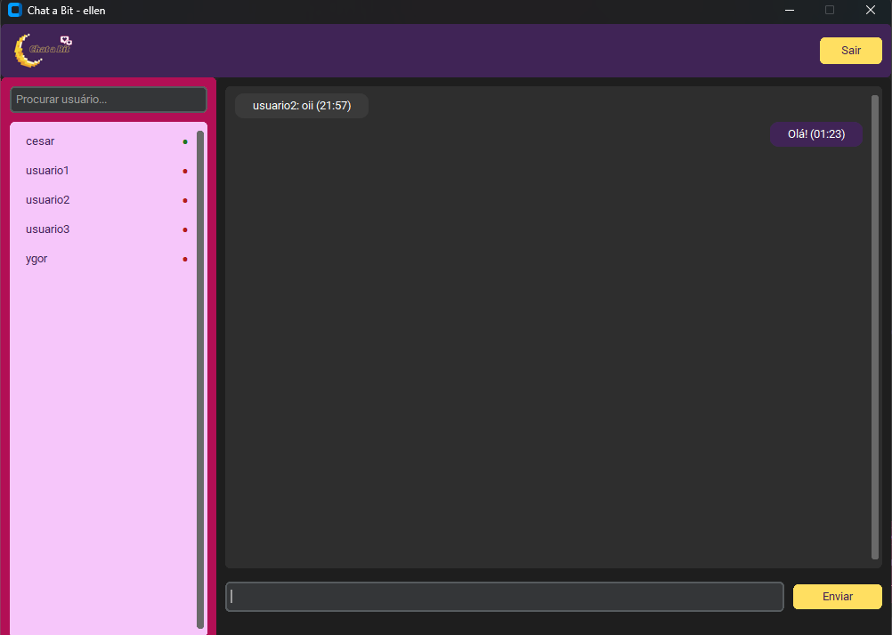

<p align="center">
  
</p>

<p align="center">
  Chat a Bit é uma aplicação de mensagens instantâneas baseada em arquitetura <strong>cliente-servidor</strong>, desenvolvida como projeto acadêmico para a disciplina de <strong>Redes de Computadores</strong> da <strong>UFRPE</strong>.<br>
  O sistema utiliza <strong>sockets TCP</strong> para comunicação em tempo real, com autenticação segura, persistência em banco de dados e interface gráfica desktop.
</p>

---

## Tecnologias Utilizadas

<p align="center">
  <br><br>
  
  
  
  
</p>

---

## Funcionalidades

- **Comunicação em tempo real**  
  Troca de mensagens instantâneas entre usuários conectados via sockets TCP.

- **Cadastro e autenticação segura**  
  Senhas criptografadas utilizando a biblioteca `bcrypt`.

- **Persistência de dados**  
  Armazenamento de usuários e histórico de mensagens em banco de dados PostgreSQL.

- **Indicadores de status**  
  Visualização de usuários online/offline e indicação visual de digitação.

- **Interface gráfica e temas**  
  Desenvolvida com CustomTkinter, incluindo temas Claro e Escuro alternáveis em tempo real, cursores personalizados e notificações internas.

- **Servidor integrado e distribuição portátil**  
  Geração de executável único (.exe) com Splash Screen integrada via PyInstaller. Ao abrir o executável, o servidor socket é iniciado automaticamente em segundo plano.

---

## Demonstração da Interface

### Tela de Login


### Tela de Cadastro


### Chat Principal


---

## Estrutura do Projeto

```plaintext
chat_a_bit/
├── assets/             # Recursos visuais (ícones, imagens, cursores)
├── banco_de_dados/     # Scripts de criação e conexão com PostgreSQL
├── config/             # Arquivos de configuração do sistema
├── interface/          # Janelas e componentes da interface gráfica
├── rede/               # Implementação de sockets (cliente e servidor)
├── utils/              # Funções auxiliares, caminhos e gerenciador de temas
├── Chat a Bit.spec     # Especificação de build do PyInstaller
└── main.py             # Ponto de entrada (UI e servidor embutido)
```

## Instalação e Execução

### Pré-requisitos

- Python 3.10 ou superior  
- PostgreSQL ativo e configurado  

---

### Clonar o repositório
```bash
git clone https://github.com/EllenRocha1/chat_a_bit.git
cd chat_a_bit
```

### Instalar dependências
```bash
pip install -r requirements.txt
```

### Configurar o banco de dados

1. Configure as credenciais do PostgreSQL em:
```bash
config/config.py
```

2. Execute o script de criação das tabelas:
```bash
python -m banco_de_dados.criar_banco
```

---

## Execução em Desenvolvimento

Para rodar a aplicação com a interface e o servidor integrado em segundo plano:
```bash
python main.py
```

> **Nota:** Caso queira rodar um servidor dedicado separadamente no terminal, você ainda pode executar `python rede/server.py`. O cliente detecta automaticamente se o servidor já está ativo.

---

## Compilação (Gerar Executável)

O projeto já possui o arquivo [`Chat a Bit.spec`](Chat%20a%20Bit.spec) configurado com todos os assets, splash screen e módulos necessários.

### Para compilar o executável:

```powershell
pyinstaller "Chat a Bit.spec"
```

O executável final portátil será gerado na pasta `dist/Chat a Bit.exe`.

> **Dica:** Ao clicar no executável (ou abri-lo pela barra de tarefas), ele iniciará tanto o servidor socket em segundo plano quanto a interface gráfica, pronto para uso sem precisar de terminal.
>
> Caso vá recompilar, certifique-se de que o aplicativo esteja fechado para evitar erro de permissão ao sobrescrever o arquivo em `dist/`.

---

### Autoria

Desenvolvido por Ellen Rocha
<p align="right">
  
</p>
